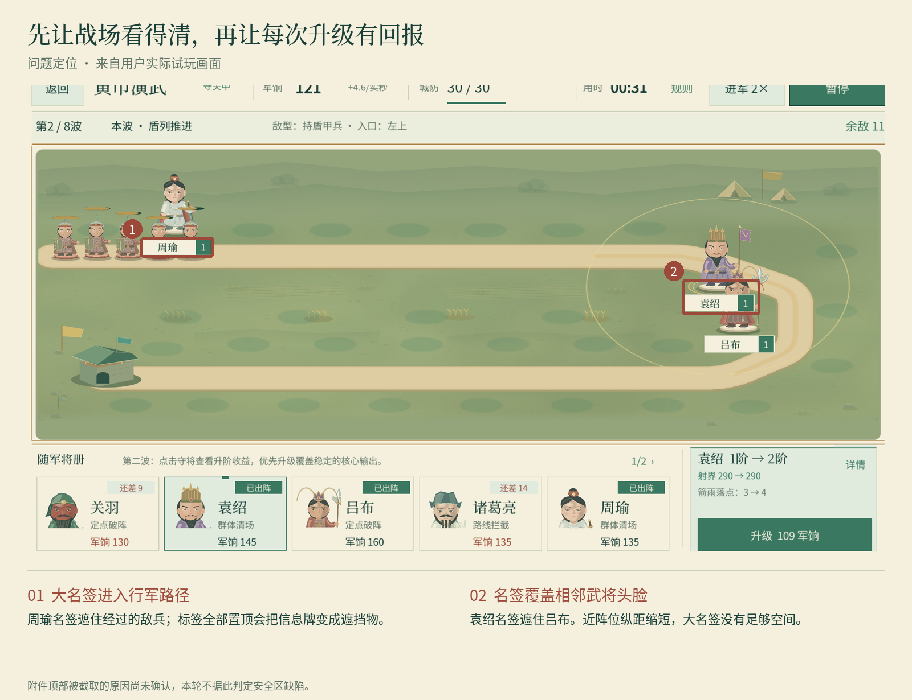
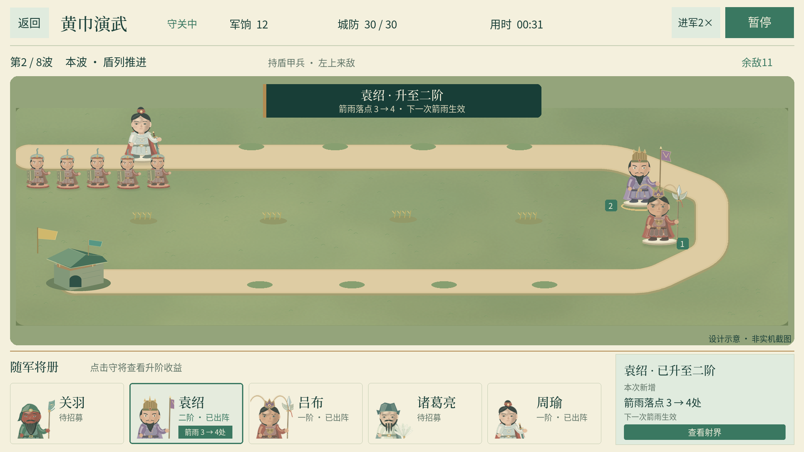
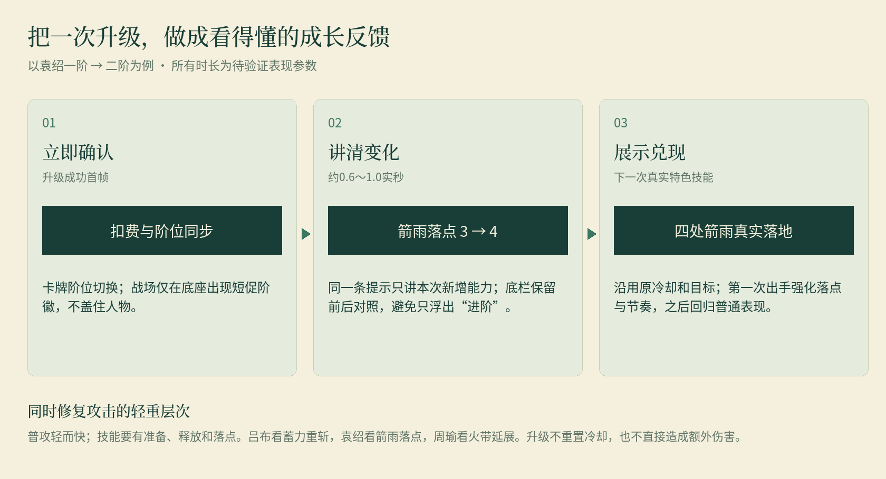
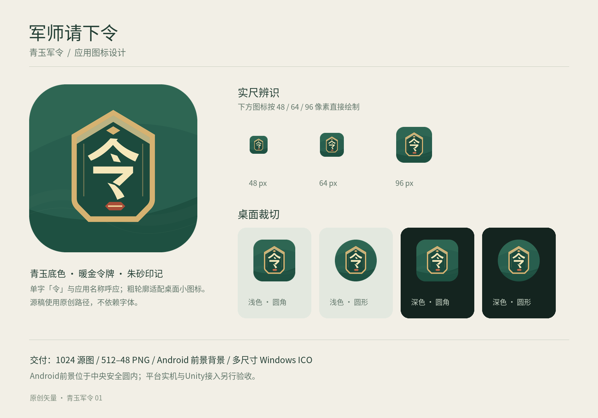

# 军师请下令：攻击、升级反馈与战场可读性方案

状态：运行时实施与自动验收已完成，见[本轮验收](faction-army-acceptance-20261112.md)；人工乐趣和真机验证待完成。资料批次：20261112。

用户最新重点是“攻击和升级反馈”，并补充升级、技能和武将配合的变化不明显。下一轮应让玩家看清“谁出手、打到哪里、升级新增了什么”，同时处理名签遮挡。保留已认可的青绿行军UI、角色与地图方向。

设计阶段交付方案、三张诊断／设计图、原创图标及[Word阅读版](combat-readability-upgrade-design-20261112.docx)，均保留。后续已接入游戏、Unity图标设置与独立包；本文件的原图仍属于设计合成，真实Unity图见 `../ui/runtime-faction-army-20261112/`。

## 1. 判断与优先级

| 优先级 | 改动 | 玩家应获得的感受 | 落地范围 |
| --- | --- | --- | --- |
| P1 | 清理常驻大名签，选中信息进入现有底栏 | 敌兵和武将头脸清楚，点击后能对应人物与卡牌 | 名签显示策略、选中底座、按需避让 |
| P1 | 建立升级确认、能力变化、首次真实技能的连续反馈 | 花军饷后立即知道变强在哪里，随后能看到兑现 | 先做吕布、袁绍、周瑜三人切片 |
| P1 | 拉开普攻与特色技能的准备、动作、命中层次 | 普攻清脆，重斩有重量，箭雨和火攻有身份 | 同上三人，不改攻击频率或伤害 |
| P2 | 分层声音、血条和射程圈；复核现有配合表现 | 密集时仍能辨认重点，配合不靠读长说明 | 延续现有效果与音频预算 |
| P3 | 推广其余武将，再研究节奏与数值 | 扩大有效体验，保留策略价值 | 根据切片试玩结果安排 |

不把这次反馈直接归因为敌人血量。上轮连破已实现，但正常参考的一倍峰值仅4／4／5，6／10档未触发，强档夹具不能代表日常体验。下一轮的主要投入应转向每次出手和每笔升级。

## 2. 已确认的原因

| 已确认问题 | 代码依据 | 含义 |
| --- | --- | --- |
| 全部名签统一位于全部棋兵上方 | `BattleView.cs:125–128` | 名签会盖住相邻人物和经过的敌兵 |
| 每名守将常驻154×36名签，固定脚下偏移 | `UnitView.cs:54–68` | 缺少按屏幕空间避让／折叠机制 |
| 地面纵向缩为0.67，人物与名签抵消缩放 | `BattleLayout.cs:9`、`UnitView.cs:41,56` | 阵位纵距缩小，人物和标签仍占原面积 |
| 升级复用招募环，主要提示“进阶” | `BattleEffects.cs:62–64`、`BattleView.cs:782` | 已有底栏升级预览，但缺少升级成功后的明确能力确认 |
| 多数技能共用近似出手动作，箭手共用纸白箭 | `UnitView.cs:189–196`、`BattleEffects.cs:156–160` | 普攻／技能、不同武将的身份与重量不够清楚 |
| 吕布真实1秒蓄力主要发出notice，未配专门铺垫 | `CombatSystem.cs:112–113`、`BattleEffects.cs:99–102` | 重斩缺少蓄力、释放、命中的完整节奏 |

周瑜名签进入敌军行军路径；袁绍名签压住吕布头脸。当前布局可计算袁绍@10与吕布@12的名签／人物矩形交叠114.7×36逻辑像素，截图进一步证实盖脸。附件顶栏裁切的来源未确认，不据此认定安全区缺陷。

目前的UI检查偏重单对象边界，还要求名签高于棋兵，未覆盖生产名签层中的多人互遮。后续应补可读性断言，不能只删掉原检查。

## 3. 方案取舍

| 路线 | 收益与代价 | 结论 |
| --- | --- | --- |
| 缩小标签、加大所有特效 | 改动快；仍存在姓名与头脸争空间、轻重混成一团的问题 | 仅作局部调参 |
| 按需显示信息＋三人攻击／升级切片 | 直接对应反馈，改动集中，可与当前版本保持玩法轨迹可比 | 推荐 |
| 重排战场纵深、重做25人动作并改数值 | 潜在收益大，变量多，难判断是哪项改善体验 | 切片确认后分开研究 |

## 4. 遮挡与信息布局

战斗常态取消全员的大矩形名签。姓名、完整阶位和升级收益放到现有下方将册与右侧详情；点击人物或卡牌时同步选中，以底座描边对应战场人物。保留原阵位命中区与输入处理，小徽章和装饰层不拦截点击。

小阶徽仅在空位足够时显示：先检查头脸、血条、道路和其他标识，尝试有限的候选锚点；无位置就折叠到卡栏。选中底座绘在人物后方。备战、暂停或主动查看时，可按需展示名字，但仍须避让。不要通过缩小角色或改变真实阵位来掩盖遮挡。

升级成功提示一次只展示一名武将、一项新增能力；在安全的HUD槽位或当前地图空白区短暂出现。图中上方位置只代表黄巾示意，不能当成五关固定坐标；与Boss预警或保护区冲突时移到底栏，预警优先。连续升级合并为该将最新阶位，其他将的确认在卡栏保留，不堆叠覆盖战场。

战斗中的射程圈在短暂查看后淡出，底栏保留“查看射界”；备战或主动查看时保持。普通满血敌兵血条可隐藏，受伤／被攻击时显示；Boss保留清楚的关键生命信息。显示时长与淡出速度都属于待试玩参数。

## 5. 攻击与升级反馈

一次成功升级分为两段。成功首帧同步军饷、阶位和卡牌状态，以短促底座反馈确认；随后约0.6～1.0实秒讲清本次能力变化，底栏保留对照。第二段等原有冷却、目标和真实事件满足后，强调升级后第一次特色技能。

不承诺“升级后两秒必施法”：技能原冷却约3～4.8秒，吕布还存在1秒蓄力。无目标时保留待兑现状态，不制造假出手；不重置冷却，不附加伤害，不强制慢放或全屏震动。

| 人物 | 一升二／二升三的真实变化 | 攻击表现重点 |
| --- | --- | --- |
| 吕布 | 前方扇面→半圆；半圆→整圈回身扫 | 真实蓄力时收势，释放时突出斩击方向与边缘，命中时短促冲击；普攻保持轻快 |
| 袁绍 | 箭雨落点3→4；轮数1→2，后轮重新瞄准 | 普攻保留单箭；技能突出真实落点与成组落地。三阶第二轮沿用原0.6秒间隔，不提前画假箭雨 |
| 周瑜 | 圆形火区→沿路火带；三阶增加离区余烬 | 首次真实火攻短暂突出延展方向与区域边缘，随后降为低干扰火区；余烬仅随真实状态出现 |

升级摘要复用`HeroGrowth.GetUpgradeSummary`的真实配置，不维护另一份数值。文案优先讲机制变化，不只突出伤害百分比。三个角色对应截图，适合在黄巾做同场比较；其他关卡必须遵守本关全部Boss禁选。

“首次强调”绑定武将实例、升级后阶位及真实特色攻击序列。一次群目标攻击只强调一轮；袁绍第二轮按原事件表现，不重复升级成功提示。连续升两阶时只等待最新阶位的有效出手；若已在蓄力，只有实际使用新阶位规则的攻击才能消耗该标记，不能仅看当前显示等级。暂停冻结战斗表现，恢复后沿原事件继续；失败升级、终局、退出和池复用不得误播或残留。

声音分为普攻、特色释放、命中、升级确认，使用音色／包络和限频区分轻重；是否好听必须实际听测。继续保留90特效、14数字及现有音频预算，预算不足时先收起低优先装饰，保留Boss预警和升级操作确认。

## 6. 武将配合的后续工作

已有诸葛亮＋周瑜的减速／火区、庞统连环真实传伤、荀彧协射来源继续保留。三人切片先让单次攻击和升阶可辨，再观察这些配合能否被玩家理解；若仍不清楚，补短促来源、状态和覆盖变化，不增加未经设计的专属倍伤。

关羽仍为单点，连环传播不能画成关羽范围攻击；协射不能递归。现有kill事件没有完整攻击者归因，不能根据附近武将播报“某组合击破”。

## 7. 图标：青玉军令

主意象采用军令牌与原创路径“令”字，直接呼应“军师请下令”。青玉底延续现有UI，厚暖金轮廓保证小尺寸辨认，朱砂小印提供暖色焦点；不塞入完整标题或复杂人物。

交付[图标说明与素材目录](../ui/app-icon-20261112/README.md)：可编辑`master.svg`，1024／512／192／96／64／48 PNG，Android 432前景、背景与单色候选，以及七尺寸Windows ICO。通用PNG为满方形，不预烘焙圆角；展示板中的圆角／圆形仅作桌面裁切预览。

Android前景非透明像素最大半径约120.169px，小于432画布中央132px安全圆；尺寸、安全区、透明度与导出哈希已校验。尚未接入Unity、打包或完成Android启动器实测，不能把裁切预览当作真机证据。

## 8. 实施顺序与验收

先实现通用名签策略和三人升级／攻击切片，补专项检查；验证后构建独立Windows体验包，与`CombatExperience-20261112`比较。有效再推广其他武将和声音，不在同一批次叠加兵血量、经济或排程调整。

| 范围 | 必须取得的证据 |
| --- | --- |
| 原截图回归 | 周瑜@2＋密集上路敌兵；袁绍@10＋吕布@12。分别选中、升级、暂停，不盖头脸；装饰不拦截人物／阵位点击 |
| 布局压力 | 五关全部近邻阵位组合、合法满10人、Boss预警与密集敌群；1280×720、1920×1080、2400×1080截图及保护区相交检查 |
| 升级正常路径 | 成功首帧确认、真实变化文案、首次特色出手只强调一次；群目标与第二轮不重复确认 |
| 空／异常状态 | 无目标、缺钱、最高阶、暂停恢复、连续升级、蓄力中升级、终局、退出重开、对象池复用 |
| 规则／经济回归 | 同配置同阵容同消费操作的1／2／3倍原玩法与军饷轨迹一致；规则／五关模拟、内容、Unity专项检查 |
| 人工体验 | 同一合法阵容做前后比较。玩家能指出刚才升阶新增能力、区分普攻与技能，并说明配合收益；记录不能辨认的攻击片段 |
| 性能与声音 | 密集战斗的特效／数字／声音预算；实际听测、手机帧率和触控另取证，不由截图推断 |
| 图标平台接入 | Unity平台设置、Windows程序资源、APK包内资源、Android圆形／异形／主题图标和启动器实测 |

本轮只验证设计文档、示意图和图标文件；未运行新UI、未生成新游戏包。Word已通过结构／文字校验；隐藏Word实例无法安全确认身份，尝试在打开文档前停止，未完成PDF导出或逐页排版检查。源码／构建输入指纹与本轮交付校验记录见[本轮规划目录](../../.planning/combat-readability-icon-20261112/)。

任何后续真实平衡调整均须独立实验并区分`growth-tempo-v2`成绩口径，保留旧纪录与旧试玩包。25将、最多10人、本关全部Boss禁选、每将每局一次、实秒攻击／状态与进军倍率规则继续保持。

## 阵营方向接续

用户已认可同阵营2／4人收益方向，具体规则另见[阵营军势设计](faction-momentum-design-20261112.md)和独立[Word补充版](faction-momentum-design-20261112.docx)。先完成本方案P1，再分领域配置与真实伤害两个批次接入军势。原Word保留为本方案的初始阅读版，阵营内容以补充版为准；新增军势不能沿用本方案“伤害与经济轨迹不变”的表现版验收。
