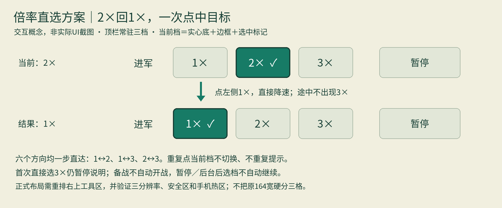
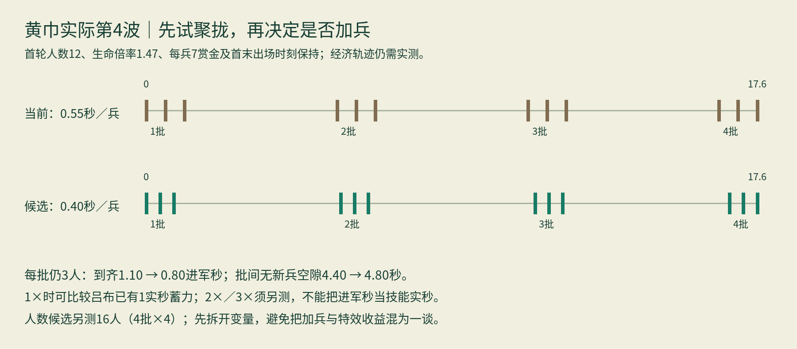
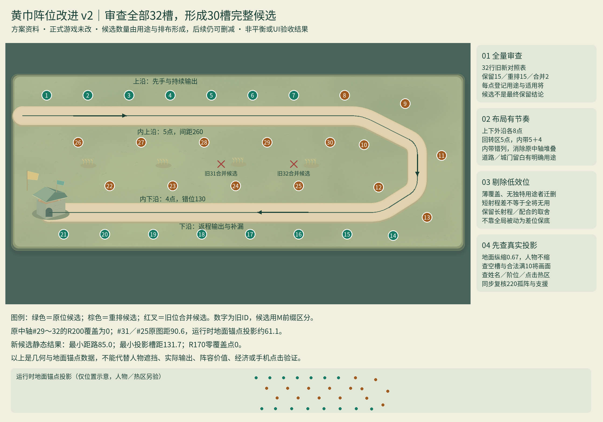

# 军师请下令：战斗爽感与布阵价值改进方案

日期：2026-11-19，修订v3（全量阵位v2＋倍率直选）。状态：具体设计稿，待实施与对比试玩。基线：Race-20261119，战斗规则faction-army-v1，竞速资格all-boss-v1。

## 1. 核心决策

继续以“不断挑战更高进军倍率，刷新个人最快通关时间”为主玩法。战斗体验要让玩家看见：敌群进入自己布下的火力区，控制把敌人留住，特色技能集中处理敌群，清场后获得继续提速的信心。

首批选择黄巾单关，打磨三个独立的代表技能样板、验证一组真实配合，并对全部32个阵位统一审查与重排。用户已认可“每处有使用价值、整体分布匀称”，本轮提供30槽完整候选，后续仍按用途验证决定删留，不以保留32或凑足30为目标。三个代表是吕布、周瑜、诸葛亮，均可在黄巾合法使用；他们不是必须同时出阵的固定三人队。黄巾当前推荐名单没有吕布，测试名单需显式加入，不能假装默认推荐已有。

“60～90秒样板”指从正常对局中截取的局部体验窗口，不把整关压缩为60～90秒。现有策略参考中黄巾常速约365.8秒、动态约307秒，这些是特定策略样本，不是关卡固定时长或本方案目标。

| 优先级 | 选定方向 | 第一批具体内容 | 玩家应感到的变化 |
| --- | --- | --- | --- |
| P1 | 特色技能有明显辨识 | 吕布重斩、周瑜火区、诸葛迟滞的来源、动作、范围和命中分层 | 不看说明也能分辨三人做了什么 |
| P1 | 击破有释放感 | 主技能一次重音、真实目标轻受击、现有3／6／10连破分档精修 | 聚在一起的敌人被集中处理，声音和退场干净利落 |
| P1 | 配合能看懂 | 先做周瑜＋诸葛亮的同阵不同站位对照 | 看见敌人在火区停留，理解布阵为何有用 |
| P1 | 阵位有效、布局匀称 | 全量审查32槽，淘汰无独特用途的低效位；覆盖预览说明剩余阵位适用性 | 可选位置值得考虑，排列清楚、疏密有序 |
| P1 | 倍率直接选择 | 顶栏并列1×／2×／3×，点目标一次直达；2×回1×不经过3× | 紧急降速及时、明确，倍率控制符合意图 |
| P2 | 敌群更适合范围技能 | 先试实际第4波的0.40秒短批；人数另做16人候选 | 有集中出手的机会，清场间仍有呼吸 |
| P2 | 全图精简重排 | 测试30槽完整候选：15原位、15重排、2旧位合并；原两槽移动方案降为历史参考 | 上下错列有节奏，短射程、长射程与配合各有合适位置 |
| P3 | 通过后扩展 | 连环＋单点、协射；再推广其他关卡和武将 | 形成更多可理解的组合，避免一次摊薄质量 |

## 2. 为什么选择这条路线

| 备选路线 | 优点 | 代价／不足 | 决策 |
| --- | --- | --- | --- |
| 全体加伤、统一降血、全关加兵 | 变化直观，易做第一眼演示 | 可能消除阵位意义，改变经济与竞速，也不保证技能被看懂 | 暂不采用；只保留受控的单波人数候选 |
| 技能表达＋局部敌群节奏＋阵位价值 | 直接对应五项反馈，能分别判断效果 | 需要真实事件、固定操作和小样本对比 | 作为主方案 |
| 手动大招、合体技、战中自由搬将 | 操作感强，宣传点明显 | 重做操作负担、规则与平衡，可能干扰倍率决策 | 首批不做 |

当前已有快普攻、独立技能、火区、风眼、连环、协射和连破。缺口是这些机制是否在合适的敌群上发生，以及玩家能否读懂结果。首批以已有机制形成清楚的战斗片段，暂不增加25套新技能或固定羁绊。

## 3. 真实基线与边界

| 项目 | 当前事实 | 对方案的约束 |
| --- | --- | --- |
| 人选 | 25将，战前最多选10；本关全部Boss禁选；每将每局最多招募一次 | 不通过免费塞将或重复招募制造强度 |
| 阵位 | 五关分别34／32／36／36／40；黄巾32 | 黄巾全量审查、允许精简；数量由有效用途与布局决定 |
| 黄巾敌军 | 8波、配置115个实例＝98主兵＋16弓手＋张角；不含运行时召唤 | 不能用截图中的数量替代正式出兵统计 |
| 现有短批 | 第4～8波主兵已有3～4人、0.55进军秒间隔 | 本轮是继续调整，不能称首次新增密集批次 |
| 双时钟 | 倍率加快移动、出兵、波间与计时军饷；我方攻击、技能、状态按有效实秒 | 1×实验不能替代2×、3×或动态切换测试 |
| 连破 | 已有固定0.7实秒窗口，3／6／10档，无额外收益 | 先精修层次，保留现有判定及收益 |
| 表现预算 | 最多90效果、14普通数字；固定11音源，普通音每实秒最多16次 | 真实区域也使用效果池，必须记录竞争和降级 |
| 移动武将 | 仅备战可调位，战中不能搬将 | 文案、示意和实验均保持此规则 |

现有自动测试、密集截图和构建成功证明的是各自的规则、布局或产物状态，尚不能证明真人爽感、实际听感或手机性能。

## 3A. P1倍率直选：任意档位一次到达

### 3A.1 决策与候选取舍

用户反馈从2×返回1×必须经过3×，这会在想降低压力时短暂提高压力。当前BattleView与GameFlow都按1→2→3→1循环；Domain.SetSpeed本来就支持明确的1／2／3目标，不需要改变双时钟规则。

| 方案 | 优点 | 代价 | 决策 |
| --- | --- | --- | --- |
| 常驻三档直选 | 目标始终可见，任意切换一次点击完成，降速可直接触达 | 比单按钮占用更多宽度，需要重排顶栏工具区 | 采用 |
| 单按钮展开菜单 | 常态占位较小，可选择任意目标 | 多一次展开操作，紧急降速较慢 | 不作为首选 |
| 加减按钮或长按返回 | 比循环更容易降一档 | 跨两档仍需多次操作，长按规则不直观 | 首批不采用 |

常驻固定顺序为“1×、2×、3×”，当前档用实心青绿底、描边和选中标记共同表示，不只依赖颜色。组名明确为“进军”，避免误解为全局快进；各档保持独立命中区。1×始终在左侧固定位置，所有倍率都不要求解锁，也不因高倍率本身加分。

### 3A.2 点击与状态契约

| 情况 | 行为 |
| --- | --- |
| 2×点1×，或3×点1× | 直接设置目标1×，不经过任何中间档；不确认、不展开菜单、不等待动画 |
| 1×点3×，或任意不同档 | 请求目标档一次，按实际会话刷新选中态；不循环、不顺带切另一档 |
| 点当前档、按住或连续重复点当前档 | 无倍率变化、无重复通知或切换记录；按钮按一次释放触发，不做长按自动连发 |
| 备战选择 | 设置待使用倍率但保持备战，不开始战斗、不计时或发钱 |
| 运行中选择 | 从输入处理后的后续推进使用目标倍率；不重算历史时间／收入，不把已排队时间片改成新倍率 |
| 普通暂停 | 可在暂停菜单内使用同款三档选择，选择后仍暂停，需点“继续”才运行 |
| 系统中断后 | 先回到明确暂停；选择倍率不能恢复战斗，也不能绕过系统恢复确认 |
| 规则等模态或胜败结算 | 模态遮罩拦截背景点击；结算中禁用倍率变更，不改终点与成绩 |

交互入口统一接收目标值，例如ChangeMarchSpeed(int targetSpeed)，UI普通与测试／无流程回退路径均传目标；删除两处循环推导。现有“任意modal不为空即拒绝”的入口需细化：只允许Pause模态内部自己的倍率控件请求，顶栏背景仍被遮罩拦截，MarchRules／其他模态及终局均拒绝。应用挂起／未激活期间不接受输入，回前台后仅允许在明确暂停界面选档。非法目标由UI入口拒绝并保持原状态，不触发异常弹窗；Domain原有1／2／3校验继续保留。刷新只读Session.Speed，不能根据上一次按钮文字猜测状态。

不同目标的快速连续点击按输入顺序处理，各次最多应用一次；界面始终显示实际会话值，不排队播放过时高亮／通知。不设置延迟降速的防抖时间，不添加切速冷却。一次有效点击1×后，新产生的首个时间片就是1×；此前已经排队的时间片保留原倍率并分别核对，下一固定步可能混合消费旧片与新片，不能重写历史，也不得为2→1新插入3×。

### 3A.3 首次说明与中断保护

沿用独立HasReadMarchSpeedIntro标记与暂停阅读：首次选择任一高倍率（包含1×直接到3×）都必须触发说明。输入回调内先设置目标并立即进入说明暂停，中间不得调用Tick或放行战斗更新；说明确认只保存已读并按原状态恢复，不再次切换倍率。说明文字显示实际选中的2×或3×。

此前运行且未被系统中断时，确认后恢复目标倍率；此前备战或普通暂停则保持原状态。说明期间切后台／失焦后，确认仅关闭说明，仍须明确继续。未确认返回／关闭不写已读，也不回滚已选目标档，恢复行为沿用原规则；之后真正切到高档时仍可提示，重复点当前档不触发。重试／重启沿用已确认标记。现有已读写入接口吞掉异常，尚不能报告保存结果；本项同步补可靠保存返回值和失败时的轻量提示，写入失败不宣称已持久保存，维持本局目标档与确认语义，不反复切档。失败路径和重启行为单独验证。

已经读过说明后，降速或提速立即生效，无重复弹窗。普通切换仅轻量更新档位及必要短通知，不改变顶栏布局；点当前档不打断战斗。暂停中的预选不记作有效切换，正式摘要继续只采集真实运行时段，不用点击次数或最高档替代实际使用。

### 3A.4 顶栏与热区

现有倍率按钮仅164设计单位宽，不能直接三等分。首版候选重排右上原规则＋倍率＋主操作区域，保持单行：规则x=1406、宽72；“进军”标签x=1490、宽48；1×／2×／3×分别x=1542／1618／1694、各宽72；开战／暂停x=1778、宽118，末端仍为1896；控件y=8、高80。组名与按钮同排，不增加顶栏第三行；规则入口继续常驻，暂停菜单也保留“倍率与竞速规则”。

以上是布局候选，不是已验证像素。在1280×720、无额外安全区时，每档约48×53像素，这不等于实际手机48dp。三分辨率及安全区都须检查，手机按实际密度验收热区、目标至少48dp；若候选仍偏小，优先重分配关卡／阶段等次级文字宽度，扩大三档和主操作，不硬塞回164宽，也不退回循环。开战／暂停与3×边界清楚，避免选档误点主操作；1×位置始终固定。

### 3A.5 验收用例

- 1／2／3全部六个有向切换都一步直达；重点对2→1逐次检查会话、进军时间片、军饷及摘要，没有3×中间状态或3×有效时长。
- 当前档重复点、长按、快速2→1→3→1、按钮刷新、重试／重开均一致，不重入首次弹窗、不重复记切换、不补播旧提示。
- 未读首次1→2与1→3分别验收；回调设置目标与说明暂停之间无战斗推进，确认不二次设置；关闭／退出、重启与已读保存正确。
- 备战、运行、普通暂停、系统暂停、说明期间切后台、终局逐项验证；选择不替代开战／继续，阅读期间无出兵／攻击／收入／计时。
- 真实手机上至少5名体验者中80%能无提示一次完成“2×降为1×”，记录误触与操作时间；每人20次指定档位点击至少19次命中作为初筛，截图不能代替触控。
- 在明确目标、相同生效时间片的固定操作下，双时钟、经济、Boss资格与固定步终点与旧SetSpeed能力一致。新操作效率允许玩家改变打法，不能要求真人两版通关时间相同。

UI自动检查须同步改成按目标档查找和点击，包括UiRaceChecks、UiGrowthChecks、UiBattleHeaderChecks等原先依赖“连续点两次就是3×”或单按钮宽度的断言；顶栏仍为两行信息，不用删掉原检查回避布局回归。

此项独立先落地，作为最快可验收的P1交互改进；不等待敌群与阵位实验。仅目标选择与布局改变、领域规则一致时沿用原战斗／资格版本；与T／N／M合包时仍使用该候选的独立版本。现阶段只制定方案，运行时循环按钮尚未改动。

## 4. 三名代表武将：从施放到结果

### 4.1 吕布：看得见的一次重斩

保留普攻0.7实秒、技能出手后4.8实秒冷却及已有1实秒真实蓄力。蓄力开始事件驱动收势，最后约0.25秒收紧局部轮廓；真实施放帧出现一次主斩和短促低频重音。命中的目标同帧给轻受击，随后用约0.2～0.35秒收势拖尾结束。以上表现时长为候选，不改变扣血时点。

一阶保持朝目标的扇面、二阶前方半圆、三阶整圈；每敌一次。范围描边来自真实几何，立绘动作增加明确的方向和幅度。主效果按施放序列一次，多目标不重复爆出多次主斩或叠加大音量。

目标是让玩家感到“一斩扫过一组人”。受击和击退分别取真实结果，不承诺每刀三杀，也不让动画播完才结算伤害。

### 4.2 周瑜：火从哪里来，烧在哪里

保留普攻0.63实秒、技能冷却3.2实秒和2.5实秒真实火区。施放时给一次从武将指向目标的短来源提示与点火重音；随后由持续区域承担画面，不把每次持续扣血都画成爆炸。

一阶显示半径95的圆区；二阶以目标位置为基准，沿实际路线向来路延伸75、向行进方向延伸115，即累计路程Travelled−75至Travelled＋115；三阶显示真实离区余烬。火区置于人物下层，建议中部透明度15%～25%、边界45%～65%作为首版美术候选。区域到期、替换与暂停均由真实快照驱动，不能为了好看延长烧火时间。

### 4.3 诸葛亮：让敌人明显慢下来

保留普攻0.735实秒、技能冷却3.5实秒。施放时强化来源与阵纹，敌军身上出现与真实减速对应的短状态标记，移动变化由规则产生。

一阶直接减速约1.3实秒，没有持续风眼。二阶才显示一个、三阶两个真实风眼，半径105、持续2.5实秒；重叠不叠。不能给一阶画出虚假的持续控场区，也不使用全屏阵图暗示全场减速。

### 4.4 统一的视听层级

| 层级 | 画面与声音规则 | 压力下的处理 |
| --- | --- | --- |
| Boss／城防危险 | 轮廓、形状与关键音清楚，始终可辨 | 优先保护，不能被清兵反馈淹没 |
| 技能主体与真实区域 | 一次施放一个主动作／主声，区域覆盖真实范围 | 保留主轮廓，减少内部粒子 |
| 命中与击退 | 受击轻、击退明确；沿用真实敌军去重及固定连破窗口 | 合并局部音，保留3／6／10层次 |
| 普攻与普通数字 | 细、小、短，避免和技能同样粗亮 | 先舍弃普通数字、普攻拖尾、次级火花和重复命中装饰 |

继续使用青绿纸面与已有名将美术。技能用方向、轮廓、节奏及短音区别；不默认使用全屏白闪、持续震屏、强制慢放或全局停顿。暂停、后台、终局不补播积压声音。

两个关键声源分别优先服务Boss危险和漏兵；同类同批事件合并为一次提示，不叠加音量。Boss危险优先于普通技能、升级与招募音；升级／招募用现有界面或普通声部降级处理。同批危险状态的视觉提示都须保留，关键音按优先级合并，不承诺任意数量事件都能独立同时播放。

## 5. 敌群：先解决相遇窗口，再决定规模

### 5.1 第一候选：只改黄巾实际第4波

选择“中军压阵”12名步兵，其他7波先保留。所有时间均为本波开始后的进军秒；这里的“第4波”是玩家看到的实际波次，不把生成器旧索引当波次。

| 参数 | 当前 | 节奏候选T |
| --- | --- | --- |
| 主兵与批次 | 12名，3＋3＋3＋3 | 相同 |
| 批内间隔 | 0.55 | 0.40 |
| 四批开始 | 0／5.5／11／16.5 | 0／5.6／11.2／16.8 |
| 首兵／末兵 | 0／17.6 | 相同 |
| 每批到齐 | 1.10秒 | 0.80秒 |
| 两批间无新兵间隔 | 4.40秒 | 4.80秒 |
| 生命倍率／单兵生命 | 1.47／97.02 | 相同 |
| 基础移速／赏金 | 53／每兵7，共84 | 相同 |

三人0.8进军秒到齐，在1×下有机会赶上吕布已有的1实秒蓄力；但目标选择、敌人死亡、射界和其他武将抢杀均会影响结果，不能仅凭间隔推算保证命中三人。

保首末不等于保经济轨迹。赏金到账、波清空、下一波起点、总计时军饷、升级机会均须对账。批间空隙变长也可能使战斗更断续；若真人觉得停顿更明显，即使局部命中人数上升，也不保留该候选。

### 5.2 人数候选：局部从12增至16

若三人短批仍不足以形成规模感，再独立测试第4波16名步兵，4＋4＋4＋4。先沿用0.55间隔，四批起点为0／5.316667／10.633333／15.95，末兵仍17.6。只有人数候选和节奏候选分别有效，才测试合并版0.40间隔、起点0／5.466667／10.933333／16.4。

16人版使配置全关115→119，该波主兵增加33.3%、全关约增加3.5%；第4波赏金84→112，额外28必须进入经济账本。保持单兵生命、速度和赏金单价，张角、精锐与其他波不随之统一削弱。首轮不同时补偿收入或改开局钱，先看新增兵带来的真实压力与收益。保首末时刻也要求重排批起点，因此结论针对完整16人候选，不声称完全分离出了纯人数作用。

单路上更密的小批不能完全替代“兵海”。若16人版仍被评价零散，先复核实际在场数、技能覆盖和画面尺寸，再决定后续扩量；不继续盲目叠加所有波次人数。

## 6. 配合：先让已有机制产生可见的因果

第一组采用周瑜＋诸葛亮，表现“减速生效、敌人在火区停留、持续灼烧”。先保留自然配合，不新增专属倍伤、免费合体技或自动组合击杀播报。

| 对照 | 固定条件 | 唯一变化／可得结论 |
| --- | --- | --- |
| 同阵布位 | 周瑜固定#5（850,215）；诸葛亮与周瑜同阶、同成本、同波、同倍率与操作 | 诸葛在#4（680,215）或#6（1020,215）；比较站位与相遇顺序，不预断上游一定更强 |
| 一阶与二阶 | 每组分别保持两边同阶，使用相同敌群起始状态 | 一阶只有直接迟滞；二阶才研究持续风眼与火带重合，不混为同一实验 |
| 阵容取舍 | 周瑜135＋诸葛135，对照吕布160＋黄忠110，均270 | 比较控场组合与直接火力的整体体验，不能单独证明协同因果 |

直线上的#4、#6与道路垂距均85，关于周瑜位置对称，单将几何覆盖相同；它们仍可能因进入射界顺序、技能触发和死亡位置不同而产生差异。实验先确定一段共同的正常开局操作，诸葛亮此前不招募；两局都从开局按同样输入推进，在第3波清空后的同一固定步，分别于#4或#6正常招募、同刻升阶，等第4波自动开始。此时除诸葛位置外，初始余额、敌群、其他武将与技能相位均须相同。若没有满足资金与存活条件的共同节点，就换较晚波次，或降为明确的非竞速机制夹具，不偷偷补钱、战中搬将或忽略前三波差异。

黄巾开局345，一阶两人共270、余75；两人均二阶累计474（各135＋升阶102），需通过正常收入与赏金支付，记录到达时点。二阶演示优先取合法对局的采样检查点，靠从开局固定输入重现；现有RaceSnapshot只是成绩摘要，不是完整战场存档，不新增整套恢复／回放系统。任何预设阶位／资金的机制夹具须标注“非竞速实验”，不得作为正常经济爽感证据。

画面仅显示真实迟滞、真实火区和状态重合。统计重合敌人秒、火区内驻留和实际扣血；“控制多烧了多少伤害”属于反事实问题，只有更严格的机制对照才可研究，首版不把它显示为战中贡献数字。

第二批再扩庞统＋关羽、荀彧＋主力输出：前者强调真实30%一次传伤，持续火伤不传、不递归；后者强调友军命中→荀彧补箭，保留1.5实秒独立冷却与真实改射条件。先保证一组易懂，再扩其他组合。

## 7. 阵位：全量审查、精简低效位、统一布局

### 7.1 设计硬标准

本节替代“仅移动#29／#30、其余30个保留”的旧方案。黄巾32槽全部登记评估，先判断用途，再决定保留、迁移、合并或删除。剩余阵位须有正常阵容中可解释、可复现的作用；覆盖预览用于说明这些位置，不用于替缺乏用途的位置找理由。

布局沿道路形成有节奏的功能带，保持整体匀称、局部间距清楚。道路、城门与必要地形留白保留，不为填满空白添加阵位。最终数量服从有效用途、可读布局与多套布阵选择，不锁死32、30或其他配额。

### 7.2 保留、重排与淘汰标准

| 决定 | 判定依据 | 处理方式 |
| --- | --- | --- |
| 保留候选 | 有先手、持续输出、转弯穿透、双段覆盖、补漏、友军支援或孤阵等明确用途 | 登记适用武将、阶位、场景和替代位；通过验证后保留 |
| 重排候选 | 用途成立，但连续攻击窗不足、与邻槽拥挤、遮挡或过强通吃 | 迁移后重新测道路覆盖、投影间距、支援及220孤阵关系 |
| 合并／删除候选 | 在登记的合法场景中持续劣于同区替代位，缺乏独特时机或组合用途；或功能重复且拥挤 | 优先合并；确认没有必要用途后删除，不靠全局被动或数量下限保底 |

覆盖道路一小段是复核信号，不单独等于无用。必须分别记录总覆盖、最长连续覆盖、敌人到达先后和真实攻击机会。中轴旧#29～#32对R200几乎相切，但R245的两段总覆盖约566、R255约633，长射程仍可能有价值；不能按吕布一人决定全图删留。

实施时完成黄巾合法24将×一／二／三阶的适用性矩阵，使用真实成长与技能几何，包含黄忠最大射界、姜维形态、曹操／荀彧友军范围以及群将220孤阵。高阶用途须有正常经济可达性，不能只凭免费三阶夹具保留差位；华佗／鲁肃可放任意处的全局被动本身也不构成独特阵位价值。

普通输出位先以1×、无额外控制的步兵为基准，检查连续可攻击窗是否至少覆盖该将两个普攻间隔；吕布另核对1实秒蓄力与真实出手。此为初筛，不能替代目标选择、技能方向、不同兵种、2×／3×及动态倍率验证。

### 7.3 当前32槽全量审查范围

| 原阵位范围 | 数量 | 重点问题与处理方向 |
| --- | --- | --- |
| #1～#8，上沿外侧 | 8 | 检查入口／弯前的截断覆盖和相邻替代；排列初步规整也须登记用途 |
| #9～#13，回转区 | 5 | 调整转弯过渡与内外间距，核对短覆盖专位、技能方向和多段覆盖强度 |
| #14～#21，下沿外侧 | 8 | 检查返程输出和末端补漏，不按总长度直接删除城门附近的位置 |
| #22～#28，下沿内侧 | 7 | 与中轴、外下沿一起整理，重点消除纵向拥挤和重复用途 |
| #29～#32，中轴 | 4 | 逐点验证长射程双段价值；不整排自动保留或自动判为无用 |

已生成32行[原位审查与候选对照表](../ui/combat-sensation-design-20261119/huangjin-formation-audit-v2.csv)，包含旧坐标、五档圆形探针中的主要覆盖数据、最长连续段、投影近邻、初步决定、新坐标和待验理由。圆形探针是静态预审，尚未完成上述24将×3阶矩阵，不能把“保留候选”理解为已验证有效。

### 7.4 完整候选M：30槽，内外分带、上下错列

基于道路形状提出一套完整30槽布局：15处原位候选、15处重排候选、2处旧位合并候选。数量由这套功能带排布形成，后续若仍有冗余继续精简。地图坐标为1920×1080、左上原点、Y向下；候选用M前缀，避免与原版相同数字ID的旧坐标混淆。M前缀仅是方案标签，正式配置沿用整数SlotId契约并交付旧新映射。

| 功能带 | 候选ID／数量 | 坐标安排与预期用途 |
| --- | --- | --- |
| 上沿外侧 | M01～M08，共8 | y=215；x=170／340／510／680／850／1020／1190／1400；先手与持续输出 |
| 回转区 | M09～M13，共5 | （1650,250）、（1480,420）、（1800,465）、（1540,595）、（1740,720）；内外转弯、方向技能及长射程多段覆盖 |
| 下沿外侧 | M14～M21，共8 | 沿用原14～21坐标；返程输出、末端补漏，仍接受用途复核 |
| 内下沿 | M22～M25，共4 | y=590；x=430／690／950／1210；返程配合与内侧火力 |
| 内上沿 | M26～M30，共5 | y=410；x=300／560／820／1080／1340；与外上沿形成输出／支援取舍 |

内带各自间距260，横向错位130，替代原先偏向下半区的内沿＋中轴排列。新内带y=410／590会失去旧中轴对R245／R255的上下直路双段覆盖，不能仅凭短射程非零就认定整体更好。旧#31／#32暂作合并候选；其长射程双段作用是否被回转区和长射程内带有效承接，是必须验证的取舍，当前没有证明它们对所有玩家都无用。

静态核算：候选距路85.0～125.2，最小原图槽距140.4，最小地面锚点投影槽距131.7；R170圆形探针均有非零连续覆盖，最短约192.1道路单位。这些值仅证明几何条件，尚不能证明实际输出、点击或人物无遮挡。

### 7.5 匀称与疏密的可执行标准

| 检查项 | 设计初筛标准 | 后续验收 |
| --- | --- | --- |
| 同带排列 | 各功能带保持自身节奏，典型相邻间距以本带中位数±25%为目标；超过1.5倍触发空洞复核 | 沿道路走向及真实投影检查，弯道例外登记原因，不强制等距方格 |
| 跨带拥挤 | 投影近邻低于120设计单位时触发拥挤复核，不直接当作不可用阈值 | 按真实人物、姓名、阶位、选中框与热区检查；最终以画面和点击为准 |
| 整体分布 | 上下内带错列，转弯内外呼应；不通过挤向另一片区域解决局部问题 | 同时检查全图轮廓和局部密度，必要道路／城门留白不计为空洞 |
| 选择价值 | 每个保留位有正常资源下可复现用途；同区替代位有可解释取舍 | 三套合法阵容、1／2／3倍及动态策略，检查无用途点与通吃强点 |

运行时地面纵向缩放为0.67，人物抵消该压缩，HeroSize为170。原#31与#25的原图距离约90.6，锚点投影仅61.1，必须把它们作为拥挤问题复核。不能用原图间距满足54或“按钮还能点”替代视觉与操作质量。

空槽图、合法满10将的代表组合、选中／升级／缺钱与Boss同屏均要检查；手机热区按设备密度验收。候选改变了保留ID之间32组跨220阈值的关系，另有两旧位合并，必须重新验证群将孤阵、曹操增益与荀彧协射，不能沿用旧两槽方案的“220关系不变”结论。

### 7.6 覆盖预览与实施约束

选中武将或备战调位时，高亮实际可触及的道路段，区分普通射界、特色技能方向与已生效持续区域。某个有长射程／支援用途的位置对当前武将偏弱时提示“覆盖偏薄，建议换位”，保留玩家部署权；缺乏任何合理用途的位置应按本节迁删，不能仅靠提示处理。

当前生成器要求30～40槽，DomainTests也断言至少30槽。这是现有内容约束，不能成为补回无价值位置的理由；若最终黄巾少于30，实施时须为黄巾同步修订数量基准及对应测试，以用途、分布和多套布阵验收代替旧数量保底，其他关卡约束单独保留。地图保护与data-only限制也须同步更新生成源、正式配置及明确的新验证基准，不能绕过失败。

旧两槽图与原静态数据保留为历史候选，不再指导实施。正式落地必须同时交付全量逐点决定、最终坐标／数量、旧新ID映射、运行时投影与满10将画面、道路覆盖及支援／孤阵变化表，再做正常经济、竞速与真人验收。

## 8. 数据与工程边界

当前可可靠利用的是去重后的skill_cast、真实区域／状态、唯一敌军实例和全局击退。attack可能是同一技能的多目标伤害尝试，不能当施放次数。

当前hit未贯穿攻击序列，raw小于0.8时可能没有hit事件；Amount也未裁剪过杀。kill没有武将及攻击序列，火区与余烬常仅保留Owner。因此不能直接做每次技能击杀数、完整伤害榜或两将组合击杀榜。

首批仅对三名代表的直接伤害、周瑜火区／余烬及诸葛真实减速采集最小来源链：会话、武将、原始施放序列、伤害类型、效果实例、触发来源、目标、时间与扣血前后值。其他来源标为未归因，不伪分给最近一次技能。真实扣血以扣血前后差值记录，致死沿用最终扣血来源，全局击退仍按敌军唯一实例去重。同强度同源火区在数值结算已按原规则确定后，以最小EffectId作为诊断标签；这仅解决标签确定性，不改变选区、伤害或现有叠加规则。

诊断默认关闭，仅开发实验启用；预分配缓冲最多16384条且每局内存上限4MiB，超限停止明细采集、记录截断及计数，相关指标判为数据不完整，不静默丢弃后照常宣称通过。关闭时不新增逐次日志对象或字符串分配；不逐击写磁盘，结束后统一导出。正式体验性能在诊断关闭下测量，对照采集时两版采用相同开关。传火、连环与协射的完整来源只在扩展这些组合前增加相应测试，不夹带进三将首批。

不得用“恰好同时迟滞＋燃烧”推断联合击杀。来源链未验证前，人工逐帧可检查技能，战中仅显示已有真实状态和全局连破。全武将冷却UI后置；若做，必须有只读的就绪待敌／蓄力／冷却状态，不能根据上次特效猜进度。

实现继续保持Domain纯C#与Unity展示分离。主要触点为CombatSystem／RuntimeTypes等的诊断来源，BattleEffects／BattleGrowthEffects／BattleSynergyEffects／UnitView／GameAudio的表现与预算，生成工具及配置的波次／阵位；现阶段只记录改动范围，不修改这些文件。

## 9. 实验顺序与正常流程

| 阶段 | 版本／交付 | 固定与变化 | 决策条件 |
| --- | --- | --- | --- |
| 0 | 基线录像、操作脚本、经济账本、诊断检查及32槽审查 | 冻结Race输入和正常经济；准备三将各阶与空场／压力场景，形成全量阵位候选 | 因果数据、重放和时间口径可信；每旧位都有初步决定 |
| 0a | 倍率直选版S | 三档目标选择、选中态、顶栏重排与首次说明；战斗参数不变 | 六方向一步直达，2→1无3×中间推进，暂停／后台和触控验收 |
| 1 | 表现版P，对照原版B | 同一关、同阵、同位、同操作，仅加强三将表达和反馈优先级 | 看得懂且偏好提高，行为轨迹一致 |
| 2 | 节奏版T，对照B；必要时再P＋T | 先只改第4波0.40短批；表现固定；两项各有效后合并 | 集中受击增加，空场、经济和Boss压力可接受 |
| 2b | 人数版N，按需开展 | 先16人＋原0.55；有效后才试16人＋0.40 | 有规模收益，额外赏金与存活压力没有破坏选择 |
| 3 | 阵位版M，对照所选版本 | 只改黄巾完整布局／数量；名单、经济、技能、波次与表现冻结，逐点登记旧新映射 | 无缺乏用途的保留点，整体匀称、无遮挡，组合与竞速仍有取舍 |
| 4 | 独立体验包及推广决策 | 先Windows对比；选定后补Android及五关回归 | 真人和实际设备证据支持，再推广 |

阶段1的覆盖预览可单独验收；录像辨识实验使用同阵位，避免把玩家改布阵的收益误当纯表现收益。无需同时维护所有候选包；失败候选留下结果即停止，后续只沿通过的基线继续。

第6节配合对照和第10节节奏主验中的#4／#5／#6／#27均指原版坐标；这些实验先冻结原图。布局M改变坐标后，按实际坐标和角色用途重新登记试验点，不照搬相同数字ID。与旧图能一一对应的位置采用同输入比较；位置被合并或用途改变时，另外用同资源、同阵容、同操作预算的策略比较，不声称这种比较只分离了一个槽的因果。

正常流程至少覆盖当前推荐队、手动加入吕布的代表队和一套替代队，记录招募与升级真实支付。固定操作遇到军饷不足时记录失败，不偷偷顺延或补钱；另一轮按“满足条件后执行”的策略测真实可玩性，并单独标记，不能与固定输入实验混用。

60～90秒录屏以第4波开始或敌群进入主战区的明确事件为锚点，两版用相同锚点。全关仍照常推进，不用剪辑隐藏等待、漏兵和失败；局部片段用于技能辨识，全关试玩用于经济、节奏与竞速判断。

## 10. 验收：先定口径，再看结果

以下为建议通过线，全部待实施测量；不是已取得的结果，也不是市场结论。先做5～8人小样本以发现方向问题，至少包含项目作者与不熟悉机制的新玩家。

| 类别 | 建议通过线 | 证据与失败处理 |
| --- | --- | --- |
| 倍率直选P1 | 六方向一次直达、2→1无3×瞬态推进，首次说明与暂停状态正确 | 按3A节逐项核对会话／时片／UI／摘要及手机点击，不能仅验按钮文案 |
| 技能辨识P1 | 5名新玩家中至少4名看完短片能指出三将的施放者与主要作用 | 隐去讲解，随机短片顺序；答错时先修动作／范围层次 |
| 主观爽感P1 | 至少5名对比者、偏好候选比例至少80%，且多数能说出具体片段 | 原版／候选交叉顺序；分开问清兵、技能、配合、疲劳，不只问总体好不好 |
| 技能与密度P1 | 预先固定第4波、1×、吕布一阶#4＋黄忠一阶#27（合计270），本波不招募升级；吕布单次技能唯一命中人数中位数提高至少1，作为T主验目标 | 两版从相同开局正常支付并推进至共同节点；统计本波全部真实施放及样本数、人数分布。2×／3×、高阶另报，不要求每格都增加1；饱和或抢杀先查场景 |
| 配合P1 | 至少4／5名能解释敌人为什么在火区停留；客观记录同阵布位的状态重合和驻留差异 | 不预设哪边必胜；若无稳定差异，暂不把此布位宣传为推荐组合 |
| 阵位用途P1／P2 | 32旧位全部有决定；每个最终保留位都有正常资源下的可复现用途，无仅为数量保底的点 | 完成24将×3阶适用性矩阵与三套正常阵容验证；缺乏用途则迁删，不把本轮静态候选当通过 |
| 布局匀称P1／P2 | 同带节奏、跨带近邻与必要留白逐项复核；候选无新增遮挡误点，至少5名体验者中80%能解释一个位置取舍 | 空槽及合法满10将、三分辨率、安全区与实际手机；投影合格不能代替人物和点击验证 |
| 节奏P2 | 对照记录主战区在场数、最长空场、尾兵耗时与清场时点；第4波首兵生成至清空期间最长空场不比基线多1实秒以上，作为初筛 | 不含固定波间等待；人数、驻留和击退曲线分开记录。空档恶化则调整或放弃，不以总时间掩盖 |
| 表现预算P1 | 峰值不超过90效果、14普通数字、11音源及16普通音／实秒；Boss危险状态持续可见、关键音按优先级合并 | 记录分级创建／舍弃／抢占、真实区域缺帧和峰值，不能只查总数 |
| 性能P1 | 相同设备同场景的P95帧耗时不比基线恶化10%以上作为初筛，同时满足已确认的设备帧率目标 | 尚无指定手机与帧率目标；实施时先记机型和基线，未测不得写真机通过 |
| 规则P1 | 纯表现同输入下伤害、金币、状态、波次、Boss资格和固定步终点逐步一致 | 1／2／3倍及动态切换，暂停／后台／终局；任何差异均查明后再接受 |
| 经济与竞速P1 | 新规则全账本可闭合；正常队有全Boss合格策略，并存在可重复的更快动态策略 | 记录失败和购买时点，不要求候选经济轨迹等同；不能仅凭夹具宣称可玩 |

密度指标依赖第8节诊断归因，不能直接从旧hit／kill事件计算。采集主战区在场数时先固定地图区域坐标；同时报告全场在场数，避免把敌军移出观察区误记为被清掉。空场指全场无存活敌军，尾兵耗时从本波末兵生成至波清空计算，按有效实秒记录。每项报告样本数；确定性重复用于确认复现，不能当成新增独立玩家或独立统计场景。

## 11. 分批工作量与交付

单开发者、沿用现有立绘与图集、不新增完整逐帧角色动画时，包含全图阵位审查与倍率直选，首轮预计约8～14个有效工作日；属于排期估算，真人反馈、素材补绘或设备问题可能延长。

| 批次 | 估算 | 交付与退出条件 |
| --- | --- | --- |
| 基线与诊断 | 1～2日 | 固定操作、可归因数据、经济账本及录屏锚点；不可信则先修数据 |
| 倍率直选P1 | 1～2日 | 三档直接目标、顶栏／菜单布局、首次说明和暂停／后台／六方向切换验证；可独立交付 |
| 三将表达与覆盖预览 | 2～3日 | 表现独立包、分阶位画面、压力与正常流程；逐步行为一致 |
| 第4波节奏／按需人数 | 1～2日 | 参数与经济对账、对照录像、正常队策略；不有效则保留表现版 |
| 全量阵位、回归与试玩 | 3～5日 | 32位决定、完整布局与数量、24将×3阶适用性矩阵、投影／满10将画面、独立体验包与真人记录 |

当前只交付方案、示意与验收设计。正式实施时每批保存自己的证据，不覆写Race及旧军势／体验版包或截图，不以当前老入口覆盖历史输出。

## 12. 版本和回归

纯表现且领域行为一致时可以沿用faction-army-v1；一旦出兵、数量、阵位、伤害或冷却改变，就切换独立战斗规则版本。T／N／M及组合实验默认禁写正式最快；若需保存实验成绩，每种候选使用独立规则标识和冻结配置指纹，不得共用一个combat-sensation-v1成绩键。仅最终选定版冻结后使用正式新版本。当前成绩键没有单独地图版本，阵位变化同样需要规则隔离。all-boss-v1仅在资格定义、Boss对账与时钟契约不变时沿用。旧成绩保留，不混榜、不补认证、不清档。

实施后基础回归包括Run-Tests.ps1、Run-FactionTests.ps1、Run-FeedbackTests.ps1、Run-RaceTests.ps1与内容verify-only；新增诊断、节奏、阵位验证须覆盖真实来源、同源区、传伤、过杀、无目标、重开与失败操作。地图变化需更新明确的新基准、旧新ID映射与原数量断言；保留其他关卡保护，不能绕过旧地图测试。

Unity展示验证覆盖三将一／二／三阶、空场、密集、满10将、缺钱、Boss预警、暂停／恢复、后台、胜败、1／2／3倍及动态切换，至少检查1280×720、1920×1080、2400×1080和安全区。Android构建、验签、实际安装、触控、性能与听感分别留证；未做的项目明确待验。

## 13. 第一批明确后置

- 全25将同步重做、全新骨骼动画、手动大招、固定合体技与复杂羁绊树。
- 全关统一加兵／加攻／降血、提高倍率上限，以及连破货币奖励或断连惩罚。
- 战中自由调位、重新设计全部地图或继续增加槽数。
- 组合击杀榜、未经归因的伤害榜和靠特效时间推算的冷却条。

第一轮完成标准是：能交出一段玩家看得懂、清兵更痛快、配合有依据、位置有取舍的黄巾真实战斗，同时仍愿意挑战更快纪录。若只提高截图热闹程度而真人没有更好的体验，就继续调整样板，不扩大范围。

## 14. 设计依据与配套文件

依据为当前正式database.json、CombatSystem.cs、HeroGrowth.cs、FactionCombat.cs、BattleEffects.cs、BattleGrowthEffects.cs、BattleSynergyEffects.cs、UnitView.cs、GameAudio.cs和内容生成器的静态核对，以及本轮只读策划／工程复核。当前未执行新战斗模拟、Unity验证、构建或真人测试。

- [最新竞速验收](race-implementation-acceptance-20261119.md)
- [策略参考](race-strategy-reference-20261119.md)
- [主改进路线图](combat-experience-roadmap-20261112.md)
- [示意图说明](../ui/combat-sensation-design-20261119/README.md)
- [v2全量静态审查数据](../../.planning/combat-sensation-design-20261119/formation-audit-v2.json)
- [32行原位审查与候选对照](../ui/combat-sensation-design-20261119/huangjin-formation-audit-v2.csv)
- [历史两槽候选数据，已由第7节替代](../../.planning/combat-sensation-design-20261119/formation-geometry.json)

Word版与本文同名，内容同步并嵌入三张示意。文档结构／内容覆盖检查与逐页渲染是不同验收；当前环境未完成Word逐页渲染，不能把XML可解析等同于所有分页美观已通过。
