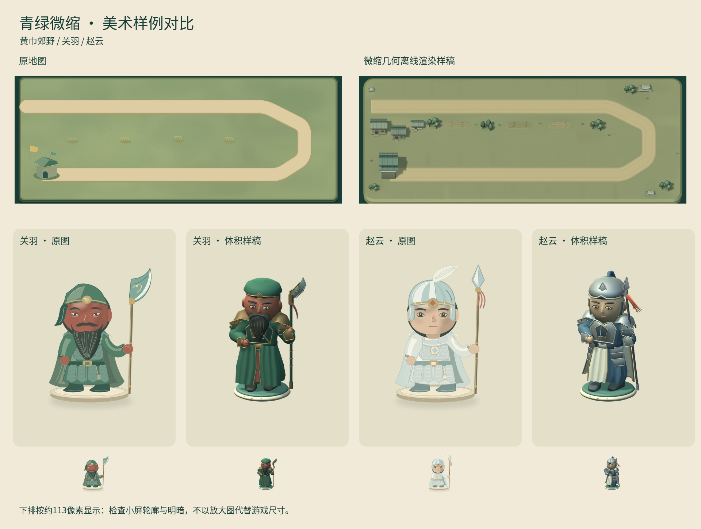

# 2.5D国风微缩沙盘：首批美术样稿

> **状态更新：用户已否决此方向。** 用户反馈“太丑”，要求转为好看的2D。v5全部版本仅作失败探索留档，不接入正式游戏。后续转至 `art-refinement-v6-2d`，不沿用下文的展示结论作为用户审美认可。

2026-11-08，最新版本 **v03**。本轮制作黄巾地图、关羽和赵云，验证体积、受光与小尺寸辨识度。当前为方向样稿，尚未接入正式游戏或重新构建Windows／Android包；未代表25名角色、5张地图全部完成。



## 查看结果

| 文件 | 内容 |
| --- | --- |
| [完整对比板](v03/comparison-overview.png) | 原地图／人物与新样稿并列，底部人物按约113像素方框显示 |
| [1280×720战场静态合成](v03/gameplay-art-sample-1280.png) | 复用既有UI截图检查小屏比例，图中已标注未接入试玩包 |
| [1920×1080战场静态合成](v03/gameplay-art-sample-1920.png) | 对齐现有地图裁切、纵缩、渐隐和人物足点 |
| [关羽透明PNG](v03/guan_yu.png)／[赵云透明PNG](v03/zhao_yun.png) | 各768×768，台座投影锚点均为(360,660) |
| [黄巾地图PNG](v03/huangjin.png) | 1920×1080，不将阵位、文字或武将烘焙进地图 |
| [技术验证清单](v03/verification.json)／[视觉审查记录](v03/visual-review.json) | 记录规格、哈希、独立复审和后续问题 |

## 本轮实现

人物通过自制几何网格塑造衣袍、肩甲、长髯、刀枪与台座，再用现有Unity 6000.3.28f1离线渲染成透明PNG。二者共用主光方向与台座规格，布料、皮肤和金属采用不同材质。地图增加厚台地、青瓦村舍、双檐城楼、树石和不规则田块，并加入低频草土变化。

渲染工具位于仓库的 `tools/artlab/`，独立工程位于 `.tools/ArtLab-v5-20261108`；工具代码未加入正式UnityGame。没有安装新依赖，也没有使用AI图片生成或外部付费API。运行时目前仍使用原素材。

## 验证证据与边界

- [Unity渲染日志](v03/render.log)最终退出码为0；两个人物台座投影断言通过，地图四个参考点误差小于0.02像素。
- 地图直接读取正式数据库的黄巾路线70个采样点与32个阵位，没有重新平滑中心线；布景采用投影范围避让道路及部署区域。
- 2张人物PNG均保留透明／不透明像素和安全边；紫红材质检查通过。6张PNG规格与SHA256登记在验证清单中。
- [渲染清单](v03/render-manifest.json)绑定4份C#、数据库和日志哈希；独立复审确认与当前文件一致。正式Assets／Packages／ProjectSettings的407个登记文件逐项匹配上一轮UI版基线。
- 独立复审已目视检查两张人物原图、地图、对比板和1280静态合成，未发现阻挡样稿展示的P1／P2问题。
- **静态合成不是运行截图。** 本轮未完成新美术在正式Unity场景、Windows试玩、Android包或手机上的实测；旧UI版验收不能作为新美术接入证据。
- v3／v4源稿、正式素材、配置、Domain、路线、阵位和既有试玩包均保留。

## 仍需打磨

| 优先级 | 问题 | 下一阶段处理 |
| --- | --- | --- |
| P3 | 人物眼神偏玩偶、视线略向下，暗部偏重 | 收敛眼球比例与视线，检查银甲和面部在小屏上的亮度 |
| P3 | 地图中央地表较均匀、场景偏空 | 增加低频草土层次及疏密变化，继续保留阵位和路线可读性 |

正式扩展前应先解决样稿观感反馈，再接入首关取得真实运行截图及交互证据，最后扩展其他角色与地图。

## 历史版本

- **v01：已拒绝的诊断稿。** 赵云台座曾出现跨场景材质失效的紫红色，地图过曝，人物神态和接缝未完成；见[v01视觉记录](v01/visual-review.json)。不能作为正式接入依据。
- **v02：中间检查稿。** 用于核对材质及曝光修正，不包含v03最终人物调整，亦不是交付定稿。
- **v03：当前样稿。** 修复材质缓存、透明边缘、眼睛、衣甲接缝，加入地表纹理；可供方向评审，尚非商业美术定稿。

## 复现

在仓库根目录用现有Unity及Python运行，选择尚不存在的新版本名，保留历史结果：

```powershell
./tools/Render-ArtSamples.ps1 -Revision v04
& 'C:/Users/chentao/.cache/codex-runtimes/codex-primary-runtime/dependencies/python/python.exe' -X utf8 -B tools/compose_art_samples.py --revision v04
```

第一步在独立工程渲染并记录输入哈希；第二步制作对比／静态合成并检查规格、材质与正式工程基线。第一步会拒绝覆盖已有版本目录；修改渲染C#后应使用新版本重新渲染。v01／v02为旧诊断记录，不使用新版校验流程重写。

设计及范围见[美术设计说明](../../engineering/art-refinement-v5-design-20261108.md)。
