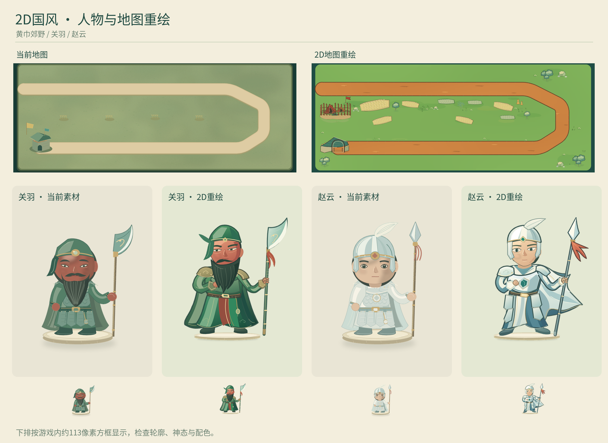

# 国风2D重绘样稿

2026-11-08，**v07 已被用户否决，不接入游戏，不作为推荐方向确认稿**。用户最新反馈：“感觉不如原版，改了之后像简单的色块拼接”。本版曾以用户提供的明快手绘塔防地图与Q版武将为参考，保留正式黄巾关的路线和阵位逻辑；下列一图两将及预览仅作失败样稿与复盘记录。

## 查看图片

| 图片 | 用途 |
| --- | --- |
| [完整对比](v07/comparison-overview.png) | 当前素材与v07并列；下排约113像素方框检查缩略轮廓和辨识度 |
| [1280静态战场预览](v07/gameplay-art-sample-1280.png)／[1920静态战场预览](v07/gameplay-art-sample-1920.png) | 按正式地图裁切和纵向缩放合成；不是游戏运行截图 |
| [关羽](v07/guan_yu.png)／[赵云](v07/zhao_yun.png) | 768×768透明全身PNG |
| [黄巾地图](v07/huangjin.png) | 1920×1080，不烘焙文字、武将和阵位 |
| [技术清单](v07/verification.json)／[视觉复核](v07/visual-review.json) | 输入输出哈希、布局数据、技术边界和视觉审查结论 |

## v07历史尝试与否决原因

地图转为更鲜明的草绿、暖橙棕土路和深色路沿，并放大西北帐篷营寨、西南守城关门；田块加入金稻、菜圃、收割草束和周边林石。关羽与赵云共用更深的轮廓与衣甲分色，同时保留关羽翠绿长髯、偃月刀和赵云银白甲、红缨枪等身份特征。

历史内部复核曾认为第二层小田与营寨拖影修整改善了构图，人物约113像素下身份仍可区分；这些记录只说明当时的局部判断，不代表美术通过。用户最新反馈明确否决了整体观感，不能继续把 v07 称作可供确认的推荐稿。

问题在画法与材质，而非装饰数量不足：低频地色叠加32个阵位周围的矩形地表清空，使草土变化断开、主体趋于平涂；农田先画封闭底板，再叠细线，细线经过纵向压缩与1280预览缩放后失效，留下明显色块；人物不同材质共用渐变与等粗轮廓，衣甲容易呈现拼板感。继续移动田块或添加同类色块不能解决这些问题。

## 实现与技术验证

- 绘图源为 `tools/art2d/characters.py`、`tools/art2d/terrain.py`；导出器为 `tools/build_2d_art_samples.py`。复用现有Pillow／Bezier绘图能力，不引入Unity几何渲染、第三方依赖或图片API。
- v07包含2张768透明人物、1张1920×1080地图、对比板及两张静态预览，共6张PNG。历史技术清单记录透明安全边、人物画布锚点(360,660)和图片解码检查通过。
- 地图直接读取正式数据库70个路线采样点和32个阵位，保留展示裁切x38..1882、y144..842及43像素道路半宽。37项装饰放置成功，2处可选花草因与浅岩重叠跳过，23簇草丝完成补点。
- 15项输入和6张PNG均登记SHA256；正式工程407个登记文件逐项匹配基线。v3／v4源稿、正式素材、配置、Domain、存档及既有试玩包保留。
- 上述均为生成时的技术记录，只说明素材格式与布局检查结果；不能覆盖用户的美术否决结论。新图未接入运行时，未重建Windows／Android，也未进行手机验证。

## 版本记录

- v01：首轮2D方向稿；发现人物造型和地图细节问题，留档。
- v02：修整人物持械手和表情；地图仍有道路主次与田块组合问题，留档。
- v03：调整道路、地表层次、农田组织与守城关楼，作为原2D方向历史稿。
- v04：首次采用用户最新手绘/Q版参考方向，强化深色线稿、暖橙路面、农田和两端焦点。
- v05：修整入口营寨周围院地，去除延伸到关楼方向的软边拖影。
- v06：在中场阵位空隙增加第二层小田，减少整片空地。
- v07：上移东侧一块中层菜圃，打破农田横向平行带；用户认为不如原版、像简单色块拼接，已否决，停止沿该画法推进和接入。
- v5：已被用户否决的2.5D探索；停止精修和接入，历史稿保留。

最新完成[局部材质研究](material-study-02/README.md)：同位置比较正式原图、被否决的v07和新实验，检查草土连续变化、路肩与作物在实际缩放下的轮廓。第一轮研究仍有土垄底座和重复草齿，第二轮已针对修整；独立复核确认拼板感减轻，但麦穗层次与道路自然度仍不足。它不是v08完整素材，也未达到参考图的手绘完成度；不作正式接入依据。人物未重画，正式资源和历史结果保留。

现有导出器拒绝覆盖已有版本。未来确需重新导出完整素材时，应使用未存在的新版本号并核对输入哈希与正式工程基线；旧版本清单保留生成时的输入指纹，不要求它与后续源码一致。

设计与实现范围见[2D重绘说明](../../engineering/art-2d-redraw-design-20261108.md)。
